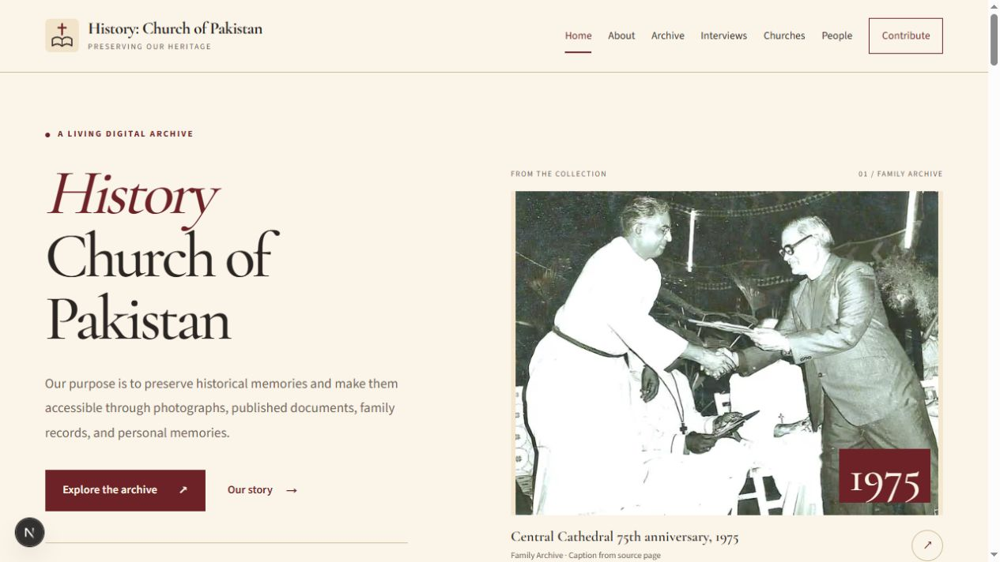
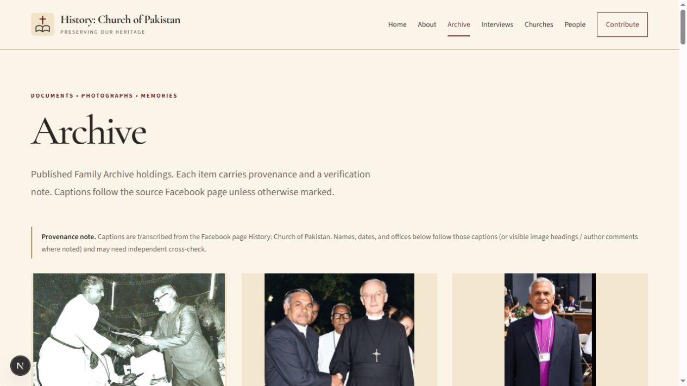
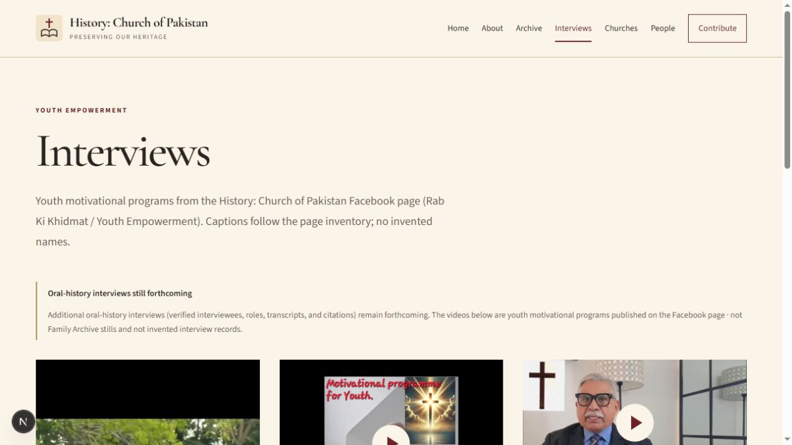
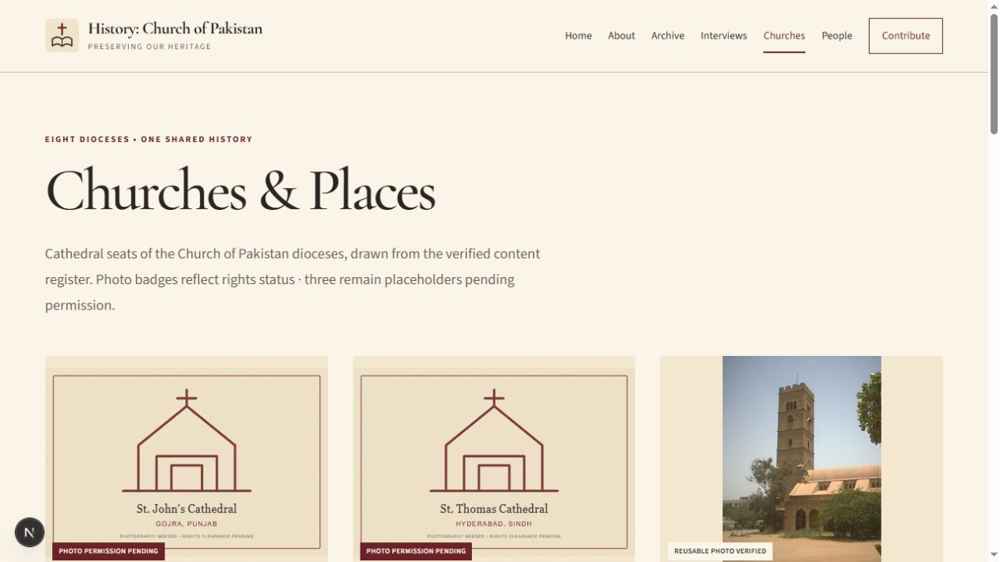
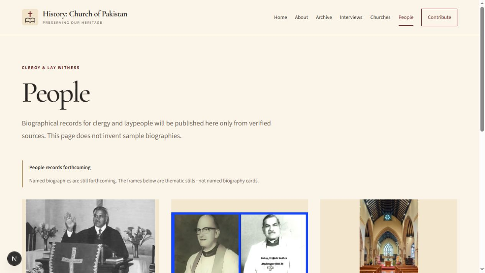
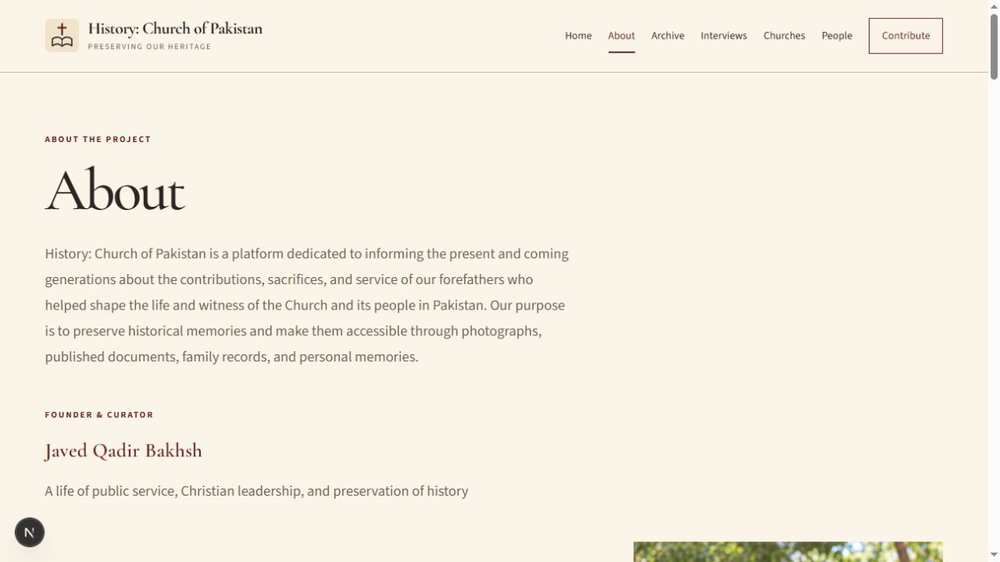
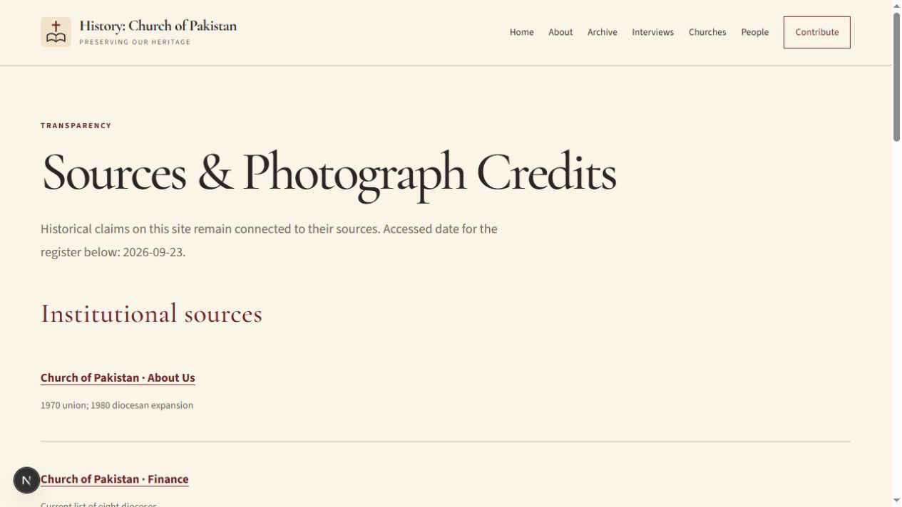
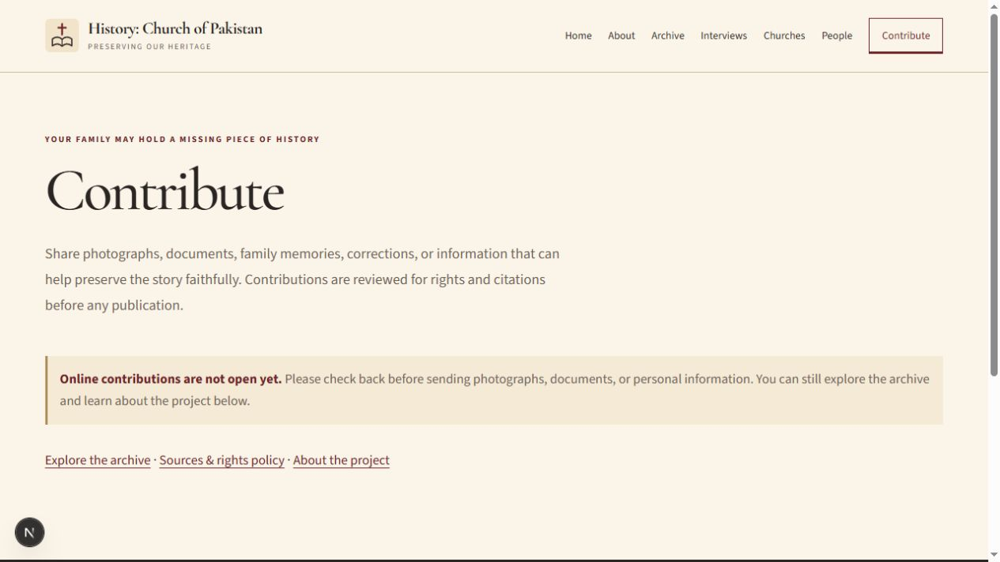
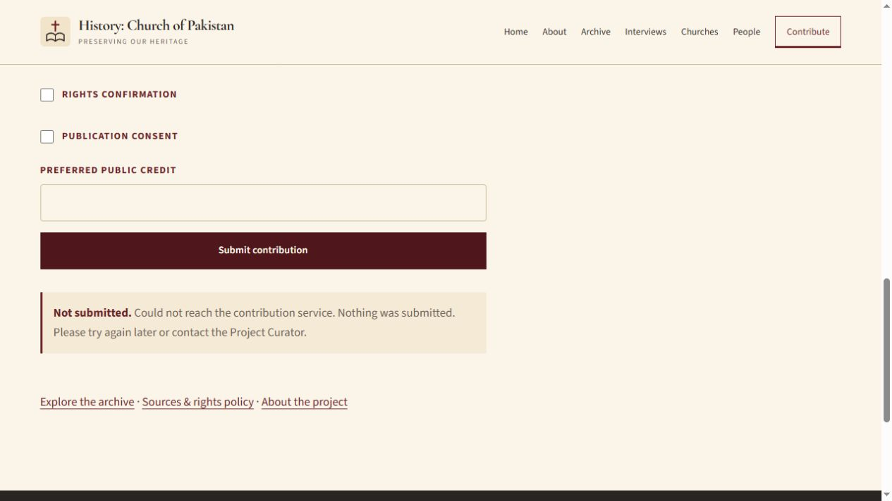

# Final design and functional review

## Verdict

The reviewed local redesign passes its build and functional checks. This is a version-control handoff, not approval to launch publicly. GitHub main already contains a separate newer redesign and blog/storage implementation. This local version is preserved on `codex/archive-redesign-reviewed`; main is not overwritten or force-pushed.

## Reviewed steps

1. **Home — healthy.** Clear archive entry point, prominent source photograph, consistent navigation. Hero media now requests eager/high-priority loading. Route changes correctly declare smooth-scroll behavior.
   
2. **Archive — healthy.** Source and verification notes remain visible; full photograph frames preserved. Individual home cards link to records.
   
3. **Interviews — healthy.** Three distinct programs, two featured at home. The shorter duplicate is removed; original posters and source aspect ratios preserve content. See the video review for full-file decoding and duplication evidence.
   
4. **Churches — healthy with content gaps.** All eight entries remain. Three clearly labeled placeholders still require permission-cleared images.
   
5. **People — honest forthcoming state.** No fabricated biographies. Publish verified biographies when available.
   
6. **About — healthy.** Readable curator story and established visual hierarchy; supplied biographical claims preserved.
   
7. **Sources — healthy.** Readable register and URL wrapping. External historical sources were not independently reverified during this visual pass.
   
8. **Contribute — availability and control fixes applied.** When intake is unconfigured, the page gives an upfront availability notice instead of a form that cannot deliver. Configured consent labels are 44px tall with correctly sized required checkboxes. An isolated production server using an unreachable loopback endpoint showed honest failure; no external submission was sent.
   
   

## Validation

- `npm run typecheck`: passed.
- `npm run lint:eslint`: passed.
- `npm run build`: passed.
- `npm run audit:site` against the production server: 8/8, content/scaffold checks passed.
- 32 responsive checks: all eight pages at 320, 375, 768, and 1440px; no horizontal overflow, a single main h1, and no broken loaded images. See `responsive-checks.json`.
- Internal links and anchor targets checked against the production build; admin redirect, disabled production preview login, and unauthenticated upload rejection checked. See `behavior-checks.json`.
- All CMS local media paths resolve.
- High-confidence credential pattern scan of changed/untracked text found no matches. Environment and session scratch files remain ignored and untracked.

## Recommendations and limits

The next valuable improvements are operational/content work: finish contribution delivery and attachment handling end-to-end before enabling public intake; supply reviewed legal/privacy pages; obtain permission-cleared images for the three pending church seats; add verified biographies and accurate video captions/transcripts. The existing admin upload dynamic-filesystem tracing warning remains and should be addressed during deployment preparation.

Screenshots plus responsive and keyboard checks do not establish full WCAG compliance. This pass did not perform a screen-reader audit, validate every external source, modify production settings, test successful external contribution delivery, or exercise authenticated CMS edits. Existing launch constraints in the onboarding briefing still apply.

## Superseded by merged-site verification

These screenshots describe commit 42e755b before integration with newer main. See [the merge review](../merge-review/README.md) for the current combined site and validation.
