# Merged-site review — 2026-10-25

The owner approved merging the reviewed archive redesign into main while retaining the newer features. This integrates redesign commit 42e755b with main at 7190bab. Earlier screenshots in final-review describe the pre-merge version.

## Preserved and reconciled

- Paper/burgundy editorial presentation, responsive cards, stable archive links, and source-proportioned videos.
- Site-wide CMS navigation, copy, SEO, editable hero photographs, admin editors, blog routes, RSS, and sitemap.
- KV document storage and Vercel Blob uploads, with local file fallback. The cloud implementations remain unchanged; local upload path tracing is now scoped to public/media, eliminating the build warning.
- Mobile focus containment and Escape focus return. Hero slideshow supports an explicit pause/resume control and reduced motion.
- Three distinct interview listings, two featured on home. The redundant alternate edit remains absent; original media files are retained.
- Unconfigured contribution intake shows an availability notice instead of a dead form.

## Verification

- Clean dependency installation using the existing main package lock.
- TypeScript, ESLint, and final production build pass. Final build has no warnings.
- Production site audit: 9/9 public routes pass. CMS content-map: 10/10 pass, including the 404 route.
- Browser: 36 page/viewport combinations (nine routes at 320, 375, 768, 1440). No horizontal overflow; one main H1 per page; no broken loaded images. See responsive-checks.json.
- Manually inspected screenshots for all nine public routes, plus mobile home/menu.
- Mobile menu opens, locks body scrolling, closes with Escape, and restores focus. Slideshow pause changes to resume with pressed state.
- The retained landscape video plays with native controls, contain sizing, a 960/720 frame, and no reported media error. Three cards on the interview page; duplicate removed.
- Contribution notice is visible and there is no form when intake is unconfigured. Browser console has no warnings/errors during the merged-site checks.
- Blog/RSS/sitemap return 200; unknown page returns 404; admin redirects to login; protected blog/site/upload APIs reject unauthenticated requests; production preview login is disabled. See endpoint-checks.json.
- All referenced local CMS media paths exist. No immutable reference originals changed.

## Remaining content/service work

Live KV/Blob writes were not exercised: no cloud storage credentials are configured locally. The blog remains an honest empty state until the curator publishes. Contribution delivery and attachment handling still require an end-to-end configured service test before opening intake. Legal/privacy pages, three permission-pending cathedral images, verified biographies, and interview captions/transcripts remain editorial/launch work documented in the existing project notes. This review does not claim a full accessibility certification or deployment verification.

## Screenshots

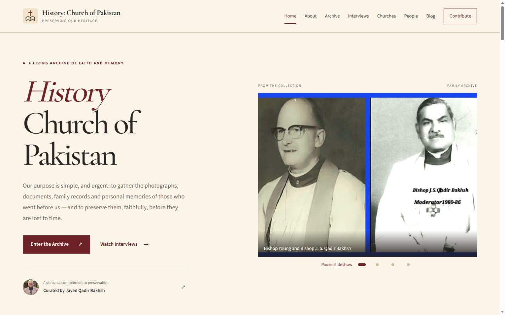
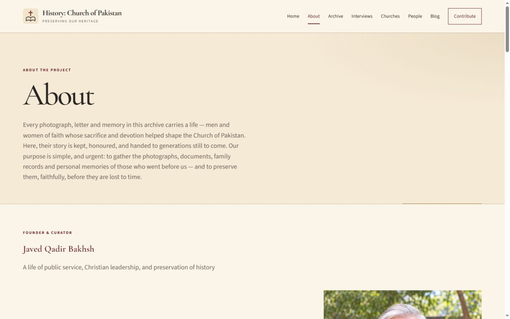
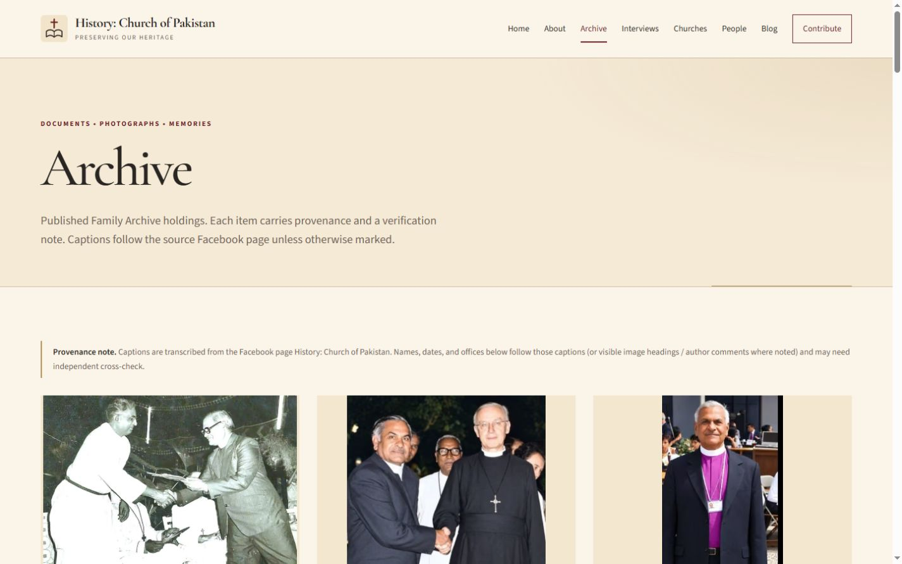
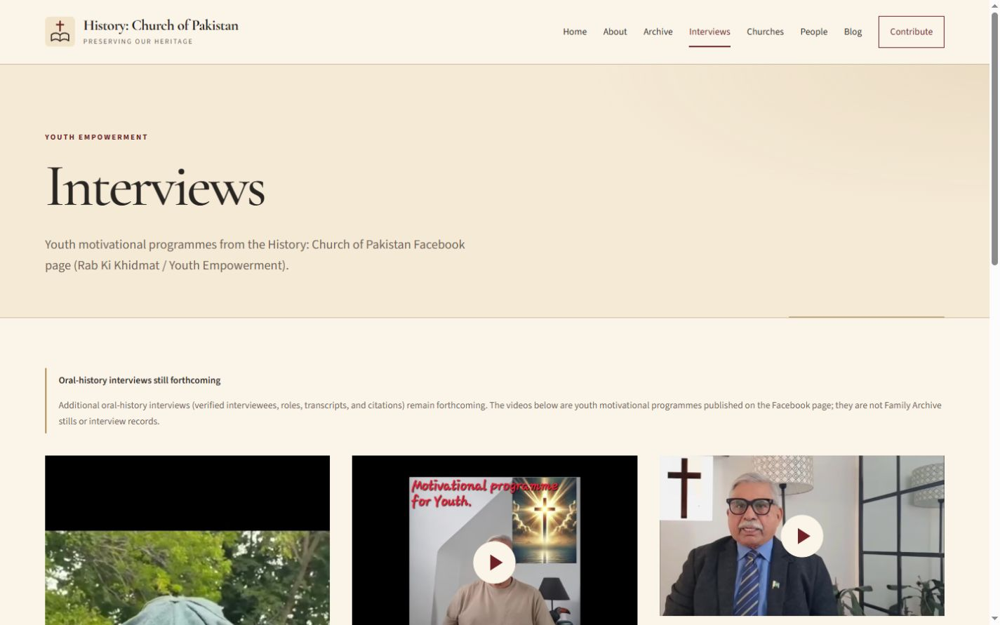
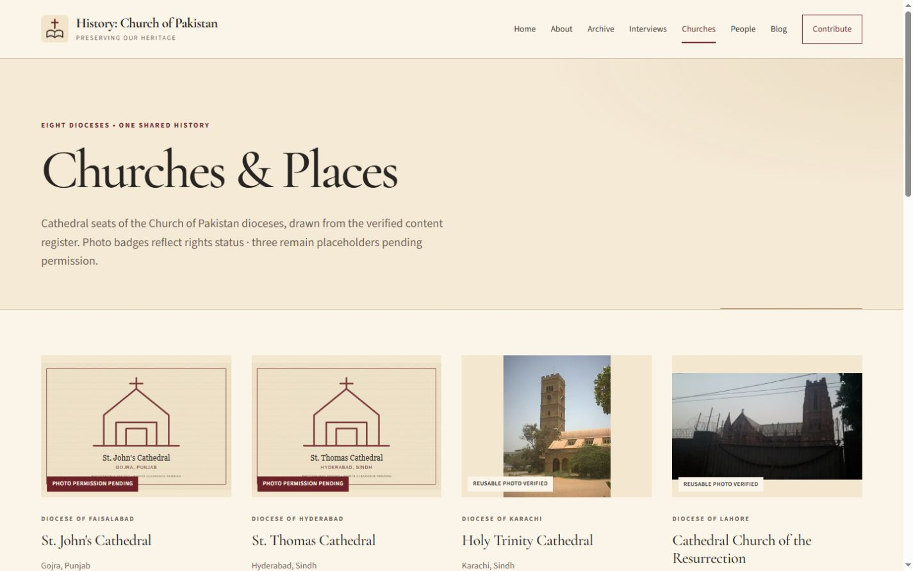
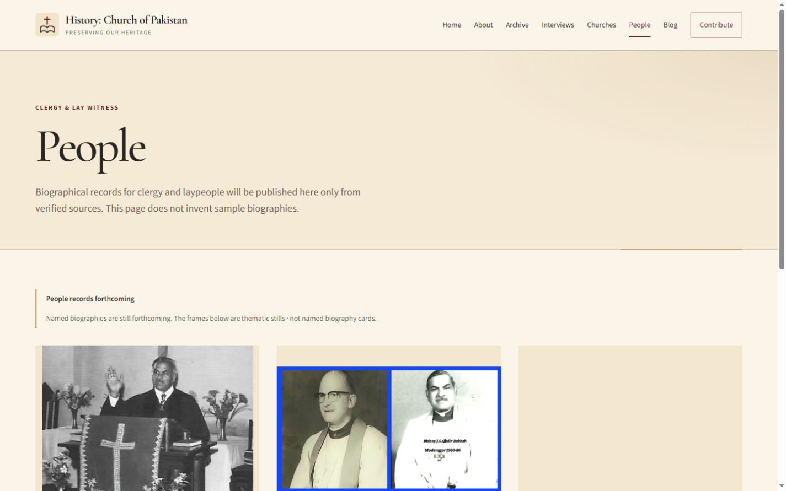
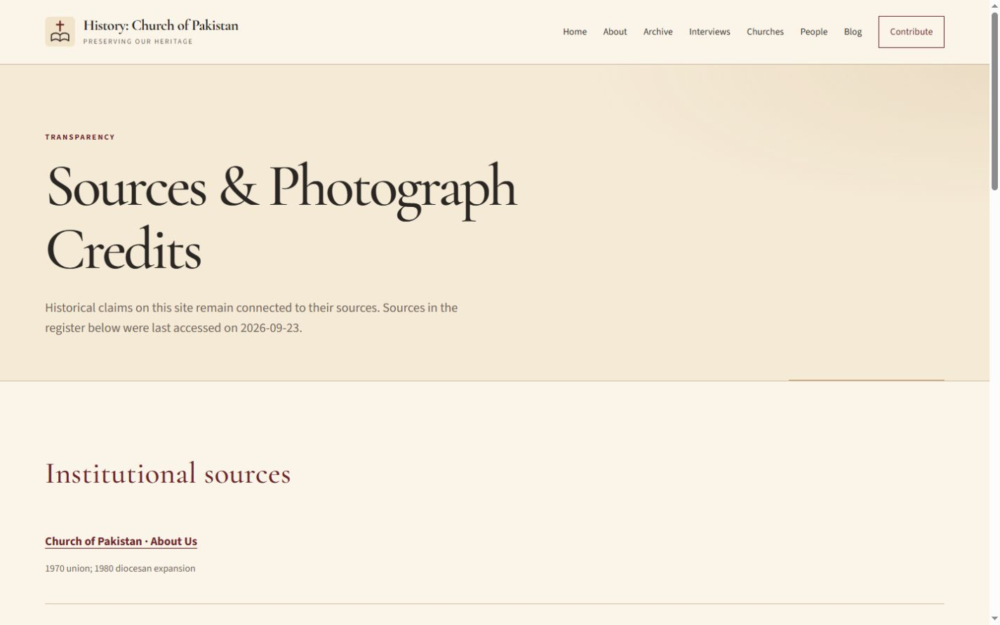
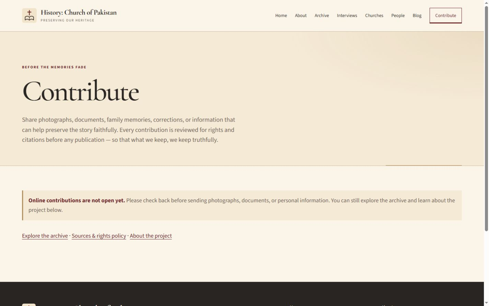
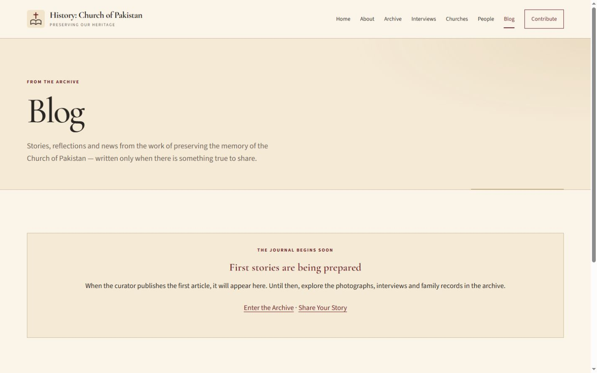
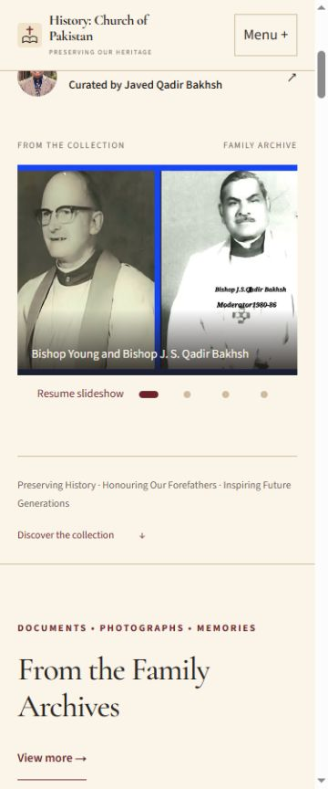
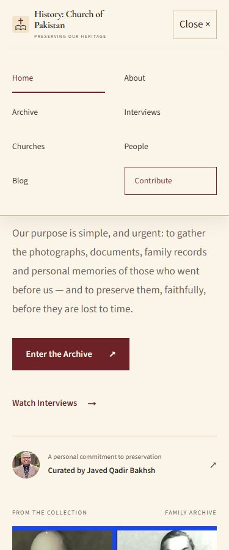
